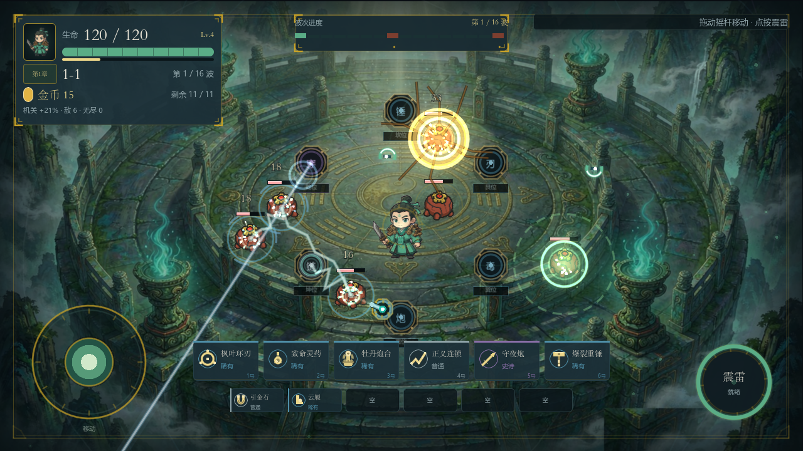
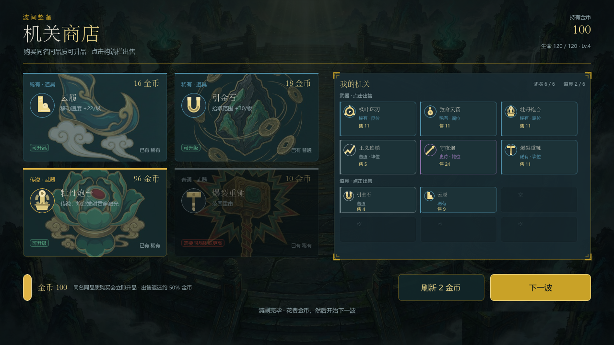

# Arena Survivor

一个用 Godot 4.4.1 做的横屏单机小游戏：你扮演机关师，在地图中央的六个台位上部署机关，靠走位和一个雷系技能活过 16 波敌人。

项目已封板（2026-10-29），不再继续迭代，代码保留作为练手与学习样本。



## 玩法

- 3 章 × 4 关，每关 16 波，第 8 / 16 波为 Boss；通关 3-1 解锁无尽模式
- 每关从零构筑：开局送机关，波间在商店买/卖/合成机关与道具
- 6 种机关：炮台、环绕刃、连锁闪电、穿透炮、冲击锤、毒液；4 档品质，同名同品质自动合成升品
- 6 种道具：磁铁、疾行靴、长明灯、招财猫、铁砧、翡翠
- 敌人：追击怪、射手、自爆兵、精英、Boss、金币怪；击杀给经验，等级提升机关与技能伤害
- 封板版本新增：命中停顿（hitstop）、受击方向提示、连击音效、7 个带主题的波次（夹击 / 同侧射手 / 自爆潮 / 包围 / 对角 / 交替 / 混合）



## 操作

| 操作 | 方式 |
|---|---|
| 移动 | 左半屏拖动（跟手摇杆），或键盘 WASD / 方向键 |
| 技能「震雷」 | 右下角按钮，或键盘 空格 / E |

机关全自动索敌开火，人物的职责是站位与放雷。

## 运行

1. 安装 [Godot 4.4.1](https://godotengine.org/)（GL Compatibility 渲染）
2. 用 Godot 打开本目录的 `project.godot`
3. F5 运行

## 导出 Android

需要安装 Android SDK、JDK 17 与 Godot 的 Android 导出模板，并在编辑器中配置好 SDK 路径。命令行导出：

```bash
godot --headless --path . --export-debug "Android" build/arena-survivor.apk
```

`data/*.json` 已加入导出白名单，否则包内会丢失平衡配置。

## 目录结构

```
scripts/          全部逻辑（GDScript，UI 由代码构建，无 .tscn 界面）
  main.gd         关卡流程、波次、经济、商店、测试入口
  weapon_manager.gd  六台机关的输出与绘制
  hud.gd          战斗 HUD / 选关 / 商店 / 结算四个界面
  hitstop.gd      打击停顿（Engine.time_scale，测试模式自禁用）
  player.gd       角色、震雷、受击无敌
  enemy_base.gd   敌人共享基类（血量/减速/眩晕/击退/受击表现）
scenes/           角色、敌人、Boss 等基础场景
data/             feel.json（打击感参数）、waves.json（波次计划）
assets/           AI 生成的美术与音效
docs/images/      README 截图
```

## 技术要点

- **数据驱动**：打击感参数在 `data/feel.json`，波次编排在 `data/waves.json`，缺文件时回退内置默认值
- **调试热键**（仅调试构建、且非测试模式）：F1 跳波、F2 清场、F3 无敌、F4 加金币、F5 开关商店、F6 变速、F7 进 Boss、F8 随机传说、F10 导出报告
- **一局遥测**：死亡/过关时写 `user://run_report.json`（Godot 用户数据目录），含每件机关伤害、受伤来源、每波用时
- **自动测试**：`--headless --path . --smoke-test` 跑冒烟测试（流程、波次、商店、Boss、存档、新波次计划断言）；`--playtest` 跑固定种子机器人 9 局
- **性能**：敌人列表按帧缓存；背景静态层与动态特效分离；特效并发上限 90

## 已知限制

- 手感与难度未经真人验证，机器人完美风筝可 9/9 通关（零受伤），真人体验可能偏松
- 只在 Android 模拟器上跑过，未上真机；未测触屏长按、低端机帧率
- 未测无尽模式长波次、未做 release 签名打包
- 单角色、单地图、无联机/账号/内购/排行榜

## 后续可优化（未实施）

- `main.gd` 中约 1100 行是冒烟测试与截图代码，可拆到独立目录，主文件能降到 1500 行左右
- `hud.gd`（2199 行）混合四个界面，可按界面拆分
- `weapon_manager.gd`（1281 行）可将六种武器改成独立策略脚本

## 说明

美术素材由 AI 生成（含色键抠图与去溢色处理），音效为合成音。本项目仅作个人学习与分享用途。
